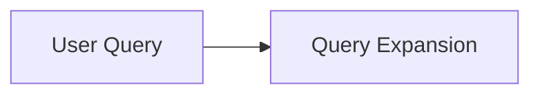

Ingest sources into a persistent, LLM-maintained wiki following the [LLM Wiki](https://gist.github.com/karpathy/442a6bf555914893e9891c11519de94f) pattern. Drop an article, paper, or note into `_inbox/` (or give a path or URL) and the agent moves inbox files into `raw/` without changing their contents, reads each source fully, discusses takeaways with you, writes a summary page, updates affected entity, concept, domain, and project pages, and appends to the wiki log. Knowledge compounds: cross-references accumulate and contradictions get flagged instead of silently overwritten. This skill also bootstraps the wiki layout on first run.

**Use when:**

- "Ingest this"
- "Add this source to the wiki"
- "File this article/paper/note"
- "Process this source"
- "Add this to the knowledge base"
- "Process the inbox"
- "I just added X to _inbox/"
- "I just added X to raw/"

**What it does:**

- Bootstrap: reads existing conventions, then creates only missing wiki files and directories. For a new wiki with no schema, it adds a CLAUDE.md schema skeleton; existing instruction files and wiki content are preserved
- Looks in `_inbox/` by default when no source is specified; moves selected files into `raw/` rather than copying them, preserving contents and avoiding overwrites
- One source at a time by default (takeaways discussed with you first); batch mode when you explicitly ask
- Writes `wiki/sources/<slug>.md` with key claims, dates, and reliability notes, citing the raw file
- Updates affected entity/concept pages, creating new pages for significant topics and flagging contradictions without silently overwriting claims
- Maintains broad domain syntheses in `wiki/domains/` and project indexes, architecture, workflow, and decision notes in `wiki/projects/<project>/`
- Keeps `wiki/index.md` (one line per page) and `wiki/log.md` current on every ingest

## Usage

Invoke the skill by name, or let a supporting agent select it for a relevant request. Automatic activation depends on the host agent and its configuration.

**Examples:**

```
Ingest the sources in _inbox/
```
```
I just added three papers to _inbox/ — batch-ingest them with less supervision
```
```
File this article into the wiki: https://example.com/sparse-attention
```

## Wiki layout

`_inbox/` and `raw/` remain siblings of `wiki/`. The compiled wiki uses this layout:

```text
wiki/
  index.md                 # catalog of all pages, by category
  overview.md              # evolving top-level synthesis
  log.md                   # append-only chronological record
  sources/                 # one summary per archived source
  entities/                # people, orgs, products, places...
  concepts/                # reusable topics, themes, methods...
  analyses/                # durable answers and comparisons
  domains/                 # broad areas of knowledge
    ai.md
    software-engineering.md
    self-hosting.md
    finances.md
  projects/                # project-specific context and decisions
    home-lab/
      index.md
      architecture.md
      decisions.md
    llm-wiki/
      index.md
      workflow.md
      decisions.md
```

Domain pages synthesize broad areas and connect related knowledge. Project folders hold local context, supporting notes, and recorded decisions. The named domain and project pages are examples, created when relevant content exists. Reusable concepts and entities stay in their shared directories and are linked from domain and project pages.

The global `wiki/index.md` catalogs every page, including project indexes and supporting pages; each project index also provides local navigation. Use qualified wikilinks such as `[[projects/home-lab/index]]` and `[[projects/llm-wiki/decisions]]` because filenames repeat across projects. Proposed decisions remain distinct from adopted decisions.

## How it works

1. Locates the wiki using your path and schema before default-path discovery. With no explicit source, looks in `_inbox/`, including subdirectories. An empty inbox is reported rather than triggering automatic re-ingestion of `raw/`
2. Moves selected inbox files into `raw/` unchanged, choosing a distinct destination on collisions. Files already in `raw/` stay in place; other explicit paths or attachments are copied unless you request a move. URL sources become new snapshots in `raw/` with the URL and retrieval date recorded. Citations use the archived path; existing raw files are never overwritten
3. Reads it fully, viewing referenced images separately when they matter; may update `tags` and `description` frontmatter and label clearly recognizable, unlabeled Mermaid fences as described below
4. Discusses key takeaways and planned page updates with you before writing
5. Writes the source summary page, updates affected entity/concept, domain, and project pages and, when the big picture changes, `wiki/overview.md`, refreshes `wiki/index.md`, and appends a `## [YYYY-MM-DD] ingest | <Title>` entry to `wiki/log.md`

If ingestion fails after a move, the agent reports the archived path and unfinished work so it can resume from `raw/`.

The source file’s `tags` and `description` YAML frontmatter fields may be added or updated. When moving an X (Twitter) post from `_inbox/` into `raw/`, a generic frontmatter `title` such as `Post by @karpathy on X` may also be replaced with a concise title grounded in the post’s content. Meaningful existing titles are preserved, along with the post text, headings, author/handle, URL, dates, and other provenance. During ingestion, the agent may also label a clearly recognizable Mermaid diagram in an unlabeled fenced code block by adding `mermaid` to its opening fence (for example, a block beginning with `flowchart LR`). Apart from these permitted frontmatter edits, diagram contents, closing fences, surrounding text, other original fields, and provenance stay unchanged. Blocks that are ambiguous or already have a language identifier are left as they are.

For example, an unlabeled block containing `flowchart LR` can become:

````markdown

````

Your wiki's own CLAUDE.md/AGENTS.md schema overrides the default layout and formats — the defaults apply only until you and the agent co-evolve something better.

## Sibling skills

This skill is one of three interoperating wiki skills in this collection:

- **wiki-query** — answers questions from the wiki with citations; files valuable answers back as `wiki/analyses/` pages
- **wiki-lint** — health-checks the wiki: contradictions, stale claims, orphan pages, missing concepts

## Full Skill Definition

See [skills/wiki-ingest/SKILL.md](../../skills/wiki-ingest/SKILL.md) for the complete agent instructions (default wiki layout, page and index/log formats, contradiction handling, and edge cases) that the agent loads when this skill is active.
