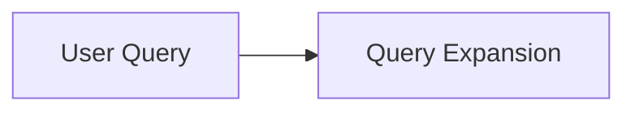

# Wiki Ingest

Build a persistent knowledge wiki that sits between the user and raw sources with immutable content: read each source fully, discuss takeaways with the user, then write its summary page and update affected entity, concept, domain, and project pages, plus the index and log, and the overview when the big picture changes. Knowledge is compiled once and kept current — not re-derived per query. This skill also bootstraps the wiki on first run. Sibling skills in this collection: `wiki-query` (answer questions from the wiki) and `wiki-lint` (health-check it).

## Layers and default layout

- `_inbox/` — incoming sources; the default place to look when no source is specified.
- `raw/` — archived sources moved from `_inbox/` or saved from URLs. Preserve source content except for the permitted Mermaid fence labeling below; `tags` and `description` frontmatter fields may be updated, with the narrow X post title exception below.
- `wiki/` — your pages. You create and maintain all of it.
- `<wiki-root>/CLAUDE.md` (or `AGENTS.md`) — the schema: conventions for this wiki, co-evolved by user and LLM.

Default layout (wiki root = current project directory unless the user points elsewhere):

```
<wiki-root>/
  CLAUDE.md                  # the schema — conventions for THIS wiki
  _inbox/                    # incoming sources awaiting ingestion
  raw/                       # immutable source content; editable tags and description frontmatter
  wiki/
    index.md                 # catalog of all pages, by category
    overview.md              # evolving top-level synthesis
    log.md                   # append-only chronological record
    sources/                 # one summary per archived source
    entities/                # people, orgs, products, places...
    concepts/                # reusable topics, themes, methods...
    analyses/                # durable answers and comparisons
    domains/                 # broad areas of knowledge
      ai.md
      software-engineering.md
      self-hosting.md
      finances.md
    projects/                # project-specific context and decisions
      home-lab/
        index.md
        architecture.md
        decisions.md
      llm-wiki/
        index.md
        workflow.md
        decisions.md
```

**Schema overrides defaults.** If a CLAUDE.md/AGENTS.md exists at the wiki root, or `wiki/index.md`/`wiki/log.md` already follow a different structure, follow the wiki's own conventions instead of everything below.

## Workflow

### 0. Locate the wiki and bootstrap missing files

Start with the user's explicit path and available project instructions. Read existing `CLAUDE.md`/`AGENTS.md` conventions before looking for the default `wiki/index.md`; a schema may specify a different wiki directory or catalog name. Project indexes under `wiki/projects/` belong to the same wiki; they are not separate wiki roots. If multiple candidate wikis remain, ask which one to use.

For a new wiki, create the top-level files and category directories above. The named domain and project pages illustrate the layout; create them only when relevant content exists, rather than generating empty placeholder pages. For an existing or partial wiki, create only missing directories and files, following its schema. A missing default index does not authorize replacing existing pages, logs, or instruction files. If no schema file exists, create a `CLAUDE.md` skeleton describing the layout, page types, and log format. If an instruction file already exists, preserve it; add wiki conventions only when requested. Tell the user where the conventions live and that they can evolve them.

### 1. Locate and archive the source

Honor explicit source paths, selections, and URLs first. Otherwise, look for source files in `<wiki-root>/_inbox/` (including subdirectories), following any schema-defined inbox path. Process discovered sources one at a time by default; discovery of multiple files does not imply batch mode. If the inbox is empty, report that and ask for a source instead of re-ingesting `raw/` automatically.

- **Inbox files:** move each selected source from `_inbox/` into `raw/` before reading it for ingestion. Move, do not copy: after a successful move, the file must no longer be in `_inbox/`. Preserve the source content and format during the move; do not rewrite or normalize it. Afterward, the `tags` and `description` fields in the source file’s YAML frontmatter may be added or updated; the Mermaid fence labeling in step 2 is the only permitted source-body edit. When moving an X post, the generic frontmatter title may also be updated as described below. Keep these metadata edits separate from the source body and preserve all other original fields and provenance. Preserve relative paths for accompanying assets so links continue to resolve. If a destination exists, choose a distinct filename or containing directory; never overwrite an archived file, even for a duplicate. Verify the move succeeded before continuing, and use the final `raw/` path in all citations.
- **Already in `raw/`:** ingest in place; `tags` and `description` frontmatter fields may be updated, and the Mermaid fence labeling in step 2 is permitted; otherwise never change its source content, replace it with another source, move it, or delete it.
- **Other explicit paths or attachments:** archive a new copy in `raw/`, preserving the original outside the inbox unless the user requests a move. Apply the same collision and content-preservation rules.
- **URLs:** fetch and save a new snapshot into `raw/` first (e.g. `raw/<slug>.md`), recording the URL and retrieval date, then ingest the saved file. Reuse an existing snapshot only when it is the intended identical source; otherwise choose a distinct filename, such as a dated snapshot with a unique suffix.

**Generic X post titles:** when moving an X (Twitter) post from `_inbox/` to `raw/`, you may replace a generic YAML frontmatter `title` such as `Post by @karpathy on X` with a concise, descriptive title grounded in the post's actual content. Preserve meaningful existing titles. This exception changes only the frontmatter `title`, not the post text, headings, author/handle, original URL, dates, or other provenance. For example, a post about maintaining an LLM wiki could use `Karpathy on maintaining an LLM wiki` instead of the generic export title.

Archiving is not completion: if reading or wiki updates fail, report the archived path and unfinished work. Resume from that file rather than treating an empty inbox as proof of successful ingestion.

### 2. Read it fully

Read the entire source — papers, articles, chapters — not excerpts. You cannot read markdown with inline images in one pass: read the text first, then view the referenced images separately if they matter. Note publication date, authorship, and quality signals as you go.

**Unlabeled Mermaid diagrams:** during ingestion, you may add the `mermaid` language identifier to an unlabeled fenced code block when its contents clearly form a Mermaid diagram (for example, one beginning with `flowchart LR`). Change only the opening fence’s language identifier; preserve every line inside the block, its closing fence, and surrounding text. Leave ambiguous blocks and blocks with an existing language identifier unchanged. This narrow formatting exception applies to the archived Markdown source as well as generated wiki pages; it does not permit rewriting diagram content or other source text.

For example, change the opening line from three backticks to three backticks followed by `mermaid` for this block:

````markdown

````

### 3. Discuss before writing

Default mode is one source at a time with the user involved: present key takeaways, the entity, concept, domain, and project pages you expect to create or update, and any contradictions with existing pages; let the user guide what to emphasize. Batch-ingest (skip the per-source discussion) only when the user explicitly asks for less-supervised bulk ingest — still surface all contradictions at the end.

### 4. Write the source page `wiki/sources/<slug>.md`

Key claims, dates, and quality/reliability notes. Cite the raw file.

```markdown
---
type: source
created: 2026-10-20
updated: 2026-10-20
source: raw/attention-is-all-you-need.md
---

# Attention Is All You Need

Raw: [raw/attention-is-all-you-need.md](../../raw/attention-is-all-you-need.md) — Vaswani et al., 2017.

**Reliability:** peer-reviewed, heavily cited; claims well-supported.

## Key claims
- Transformers replace recurrence with self-attention alone. (§3, raw/attention-is-all-you-need.md)
- ...
```

Use real current dates (ISO `YYYY-MM-DD`). Frontmatter is optional but recommended (enables Obsidian Dataview) unless the schema says otherwise.

### 5. Update entity and concept pages

For each significant entity or concept the source touches, create or update `wiki/entities/<slug>.md` or `wiki/concepts/<slug>.md`. Slugs are filenames; cite claims with `[[sources/<slug>]]`. Update every affected page, but create new pages only for significant entities or concepts; there is no target page count.

```markdown
---
type: entity
created: 2026-10-10
updated: 2026-10-20
sources:
  - "[[sources/attention-is-all-you-need]]"
---

# Google Brain

Google's AI research org; introduced the Transformer. ([[sources/attention-is-all-you-need]])
```

**Contradictions: never silently overwrite.** When new information conflicts with what a page says, add a `## Conflicts` section (or an inline note) citing both sources, and mention it to the user:

```markdown
## Conflicts
- [[sources/attention-is-all-you-need]] says X; [[sources/rnn-notes-2024]] says Y. Unresolved as of 2026-10-20.
```

### 6. Update domain and project pages

- `wiki/domains/<domain>.md` synthesizes a broad area (such as AI, software engineering, self-hosting, or finances) and links relevant entities, concepts, sources, analyses, and projects. Update it when the source changes that area's understanding or useful connections; avoid copying entire summaries into it.
- `wiki/projects/<project>/index.md` introduces a project and links its supporting pages. Store project-specific architecture, workflow, and decisions in named pages such as `architecture.md`, `workflow.md`, and `decisions.md`. Keep reusable knowledge in entities/concepts and link it from project pages. Record decisions only when supported by the source or user; distinguish proposals from adopted decisions and preserve earlier decisions when superseded.

Create only relevant pages, cite supporting source summaries, and preserve conflicts using the same rules as entity/concept pages. Add new or materially changed project pages to their project's index. Use qualified wikilinks such as `[[domains/self-hosting]]`, `[[projects/home-lab/index]]`, and `[[projects/home-lab/decisions]]`; bare `[[index]]` or `[[decisions]]` is ambiguous across projects.

### 7. Update `wiki/overview.md`

Only if the source changes the big picture — keep the synthesis short and evolving.

### 8. Update `wiki/index.md`

Add or update one line per page in the right category: wikilink + one-line summary. The index catalogs every page, including domain pages, project indexes, and project supporting pages — keep every entry to one line. Project indexes provide local navigation in addition to this global catalog.

```markdown
# Index

## Entities
- [[entities/google-brain]] — Google's AI research org; introduced the Transformer

## Concepts
- [[concepts/self-attention]] — attention within one sequence; core of Transformers (1 source)

## Sources
- [[sources/attention-is-all-you-need]] — Vaswani et al. 2017; introduced the Transformer

## Analyses
- (filed by wiki-query)

## Domains
- [[domains/ai]] — synthesis and connections across AI topics

## Projects
- [[projects/llm-wiki/index]] — LLM wiki project and supporting notes
- [[projects/llm-wiki/workflow]] — source ingestion and wiki maintenance workflow
- [[projects/llm-wiki/decisions]] — recorded project decisions and rationale
```

### 9. Append to `wiki/log.md`

Append-only, newest last:

```markdown
## [2026-10-20] ingest | Attention Is All You Need
- Wrote [[sources/attention-is-all-you-need]] from raw/attention-is-all-you-need.md
- Created [[entities/google-brain]], [[concepts/self-attention]]; updated [[concepts/seq2seq]]
- Conflict flagged on [[concepts/seq2seq]] (vs [[sources/rnn-notes-2024]]) — awaiting user resolution
```

The `## [YYYY-MM-DD] ingest | <Title>` prefix keeps the log parseable: `grep "^## \[" wiki/log.md | tail -5`.

## Edge cases

- **Schema overrides defaults**: if CLAUDE.md/AGENTS.md at the wiki root (or the existing index.md/log.md structure) defines different conventions, page types, or formats, follow those instead of this skill's defaults.
- **Duplicate or updated edition**: check the index and log before writing. If the new file is a new edition of an already-ingested work, update the existing source page (bump `updated`, note the edition, refresh claims) instead of creating a near-duplicate. Create a separate page only for a genuinely distinct document, and cross-link the two.
- **Low-quality or wiki-contradicting sources**: do not reject them — record reliability notes on the source page, flag contradictions on the affected pages, and let the user weigh the evidence.
- **Non-text sources** (images, data files): reference them from the source page and related pages; view images for context when useful; describe data files from inspection.
- **The wiki is just a git repo of markdown** — don't overengineer. Version history is free.
